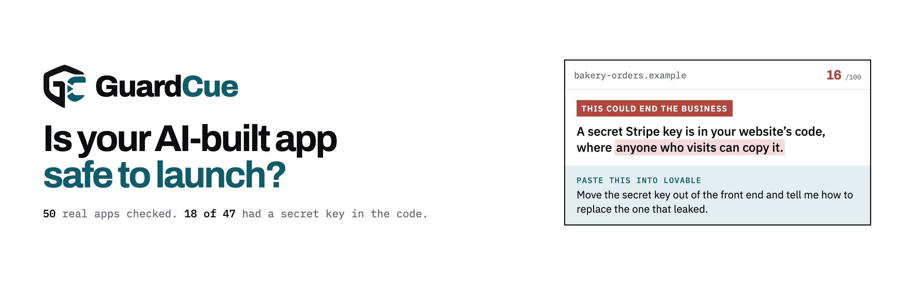

<picture>
  <source media="(prefers-color-scheme: dark)" srcset="readme-banner-2560x800-dark.png">
  
</picture>

GuardCue checks websites and apps built with AI tools (Lovable, Bolt, Cursor, v0, Replit, Claude Code) and tells the person who built them, in plain English, what could cost them money and how to fix it.

Give us your web address. We look at your live site the way a stranger would, then explain each problem by what it costs you, with the exact words to paste into the tool you built with.

**[Check your site, free](https://guardcue.com/?utm_source=github&utm_medium=social&utm_campaign=profile)**: no sign up, about a minute.

### What we look for

* A database anyone on the internet can read
* A secret key or password sitting in your code
* A paid service (AI, email, text messages) a stranger can run up
* One customer able to see another customer's data
* Speed, accessibility and search problems that lose you visitors

### What we found in real apps

In October 2026 we checked 50 real apps built with AI tools. 18 of the 47 whose code we could read had a secret key in it, and 17 had a paid service anyone could run up. [Read the study](https://guardcue.com/research/fifty-apps).

### Use it from your AI coding tool

GuardCue connects to Claude Code, Cursor, VS Code and other tools that support MCP, so your agent can check your site, fix what it finds and confirm the fix is live. [How to connect](https://guardcue.com/connect). Listed in the official MCP Registry as `com.guardcue/guardcue`.

### Free guides

* [Vibe coding security checklist](https://guardcue.com/vibe-coding-security-checklist)
* [Supabase says "RLS disabled in public"](https://guardcue.com/supabase-rls-disabled-in-public)
* [An API key was exposed: what to do](https://guardcue.com/api-key-exposed-what-to-do)

[guardcue.com](https://guardcue.com) · support@guardcue.com · Made by [Hexspire](https://hexspire.io)
